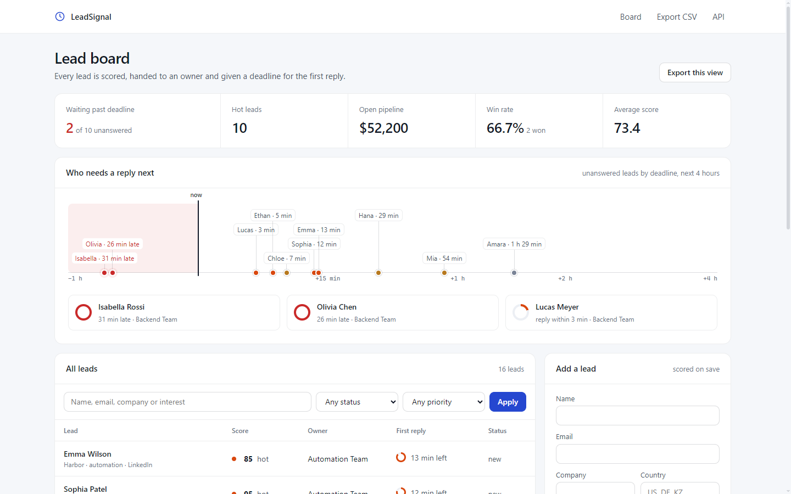
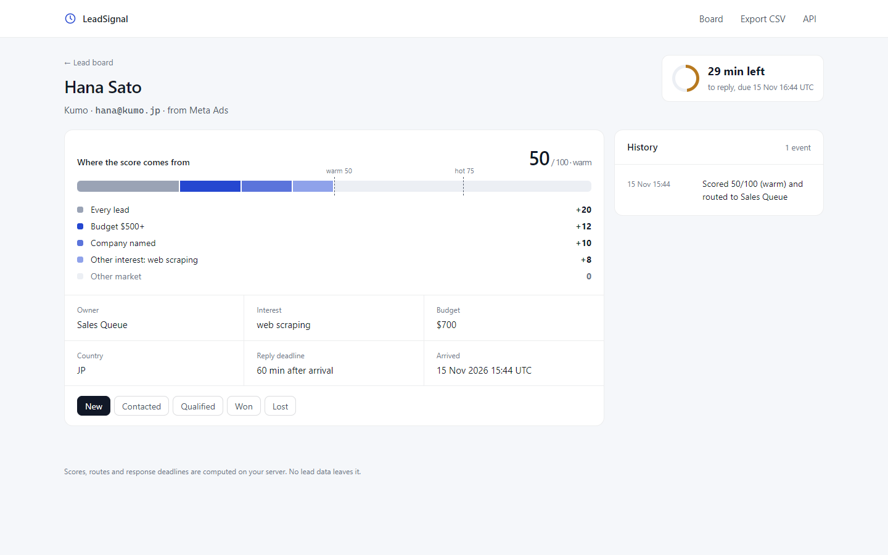
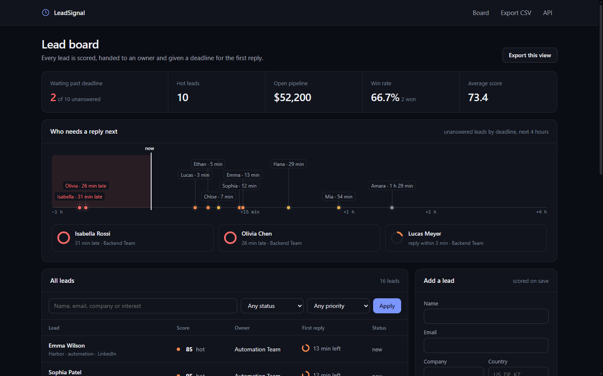

<div align="center">

# LeadSignal HQ

**Әр кіріс лид баға, жауапты адам және бірінші жауаптың мерзімін алады. Тақта ешкім ұзақ күтіп қалмас үшін кімге келесі болып жауап беру керектігін көрсетеді.**

[](https://github.com/artyom129/leadsignal-hq/actions/workflows/tests.yml)


**🌐 Тіл:** [English](README.md) · [Русский](README.ru.md) · **Қазақша**



</div>

---

## 📌 Неге жасадым

Мәмілелердің көбін бірінші жауап шешеді. Жарнамадан, сайттағы формадан немесе серіктестің API-інен келген лид екі сағат күтсе, менеджер қоңырау шалғанда әдетте басқа біреуді тауып қойған болады. Ал шағын командалар лидтерді әлі де қолмен, ортақ поштада, келу ретімен сұрыптайды.

LeadSignal HQ ретті анық етеді. Әр лид кез келген адам оқи алатын ережелер бойынша баға, не сұрағанына қарай жауапты адам және басымдығына қарай жауап мерзімін алады: ыстық лидтерге 15 минут, жылыларға бір сағат, қалғандарына төрт сағат.

```text
Сайт / жарнама / API
        ↓
тексеру және қалыпқа келтіру · email бойынша қайталауды бұғаттау
        ↓
баға 0-100 → hot · warm · normal
        ↓
бағыт: Backend, Automation, Senior Sales немесе жалпы сату кезегі
        ↓
жауап мерзімі → тақта → күйлерді ауыстыру → CRM үшін CSV
```

## 🔄 Осы нұсқада не өзгерттім

| Не | Не таптым | Не істедім |
| --- | --- | --- |
| Енгізу | Кез келген жол email ретінде қабылданатын; `NaN` немесе `-5` бюджеті тікелей бағаға кететін; сайттағы формадағы қате бюджет жалаң 422 бетімен құлайтын | Email, аты және бюджет тексеріліп, қалыпқа келтіріледі; форма мәселені қарапайым сөзбен түсіндіреді |
| Қайталау | Тексеру «алдымен қарау, сосын қосу» түрінде болды, бірегей индекссіз, сондықтан бір мезгілдегі екі сұрау екі лид жасайтын | Email бойынша бірегей индекс, жарыс ұсталып, «қайталау еленбеді» деп өңделеді |
| Бағыттау | «capital markets» ішінде «api» болғандықтан бэкенд командасына кететін; «data pipeline» жалпы сату кезегіне түсетін | Бағыт тұтас сөздерді іздейді; пайплайн жұмысы Automation-ға барады |
| Баға | «United States», «Germany» және артық бос орындары бар «API  Integration» танылмайтын | Ел аттары да, кодтары да есептеледі; қызығушылық регистр мен бос орынға тәуелді емес; балдар бір жерде жиналған |
| Мерзімдер | Хабарласып қойған лидтер әлі де кешіккен болып саналатын | Мерзім бірінші жауапқа қатысты, сондықтан тек қозғалмаған лид кешіге алады |
| Күй | Күй ретінде кез келген сөз, тіпті «banana» да қабылданатын | Бес күй, қалғаны 422 жауабы |
| Іздеу | Іздеу де, сүзгі де, беттеу де жоқ еді; сұраудағы `%` бәрін табатын | Аты, email, компания және қызығушылық бойынша іздеу, сүзгілер, беттеу, `%` пен `_` кәдімгі мәтін ретінде |
| API | Беттеусіз бір тізім | Беттеу, жеке лид, күйді ауыстыру, статистика және формуласыз CSV экспорты |
| Қосалқы бөлік | `datetime.utcnow`, кестелер импорт кезінде жасалатын, үлгілер тек бір жұмыс қалтасынан табылатын, `/health` әрқашан «ok» | Уақыт белдеуіне қауіпсіз уақыт, іске қосылғанда ескі дерекқорларды көшіру, абсолютті жолдар, дерекқорды тексеретін денсаулық |
| Интерфейс | Кесте және алты бірдей цифр карточкасы | Диспетчер тақтасы, ол туралы төменде |

### 🎨 Дизайн

Тақта диспетчерлік бөлмедегі ұшу экраны сияқты жасалған. Суық сия реңді бейтарап түстер, бір көк акцент және тек басымдықты білдіретін үш түс: hot, warm, normal.

Жоғарыда жауаптар шкаласы: әр жауап берілмеген лид өз мерзімі біткен сәтте тұрады, сол жақта бір сағат кешігуден оң жақта төрт сағат алдағыға дейін. Шкала түбір бойынша, сондықтан шұғыл лидтер тұрған жақын он бес минут кейінгі екі сағаттай орын алады. Оның астында бірінші жауап беру керек үш адам. Әр лидтің кішкентай жауап сағаты бар: толық сақина бүкіл уақыт алда екенін, қызыл кешігуді білдіреді.

Әр лидтің бетінде оның бағасы қайдан шыққаны көрінеді: warm және hot шектері белгіленген бес бөліктен тұратын бір жолақ. Менеджер лидтің неге ыстық екенін және ыстық болу үшін не жетпейтінін бірден көреді.

| Лид | Тақта, қараңғы тақырып |
| --- | --- |
|  |  |

## 🧮 Баға қалай есептеледі

| Бөлік | Балл |
| --- | --- |
| Әр лид | 20 |
| Бюджет $500 / $2 000 / $5 000 бастап | 12 / 25 / 35 |
| Компания көрсетілген | 10 |
| Негізгі қызмет (automation, API integration, FastAPI, CRM integration, data pipeline) / басқа | 20 / 8 |
| Басым нарық (АҚШ, Канада, Ұлыбритания, Австралия, Германия, Швейцария) | 10 |

75 және одан жоғары hot (15 минутта жауап), 50 және одан жоғары warm (60 минут), қалғаны normal (4 сағат). Ең жоғары мүмкін баға 95.

## 🚀 Жылдам бастау

Python 3.11 немесе жаңарақ.

```bash
python -m venv .venv
# Windows: .venv\Scripts\activate
# macOS/Linux: source .venv/bin/activate
pip install -r requirements.txt
python seed_demo.py        # 16 лид, біразы кешіккен, біразы бірнеше минуттан кейін
uvicorn app.main:app --reload
```

Тақта: http://127.0.0.1:8000 · API құжаты: http://127.0.0.1:8000/docs

### Docker

```bash
docker build -t leadsignal .
docker run -p 8000:8000 leadsignal
```

Басқа дерекқорды қолдану үшін `LEADSIGNAL_DB_URL` орнатыңыз.

## 🌐 API

| Маршрут | Не істейді |
| --- | --- |
| `POST /leads` | JSON-нан лид жасайды; лидті және оның жаңа екенін қайтарады |
| `GET /api/leads` | `q`, `status`, `priority`, `limit`, `offset` бар тізім |
| `GET /api/leads/{id}` | Бір лид |
| `PATCH /api/leads/{id}/status` | new, contacted, qualified, won немесе lost күйіне ауыстыру |
| `GET /api/stats` | Жиынтық, ыстық лидтер, кешіккендер, жеңіс үлесі, жұмыстағы сома |
| `GET /api/leads/export.csv` | Ағымдағы көрініс CSV түрінде, Excel-де ашуға қауіпсіз |
| `GET /health` | Дерекқорды тексереді |

## 🧪 Тесттер

```bash
pytest -q
```

Жадтағы дерекқорда 63 тест: енгізуді тексеру, қайталаулар мен бірегей индекс, баға сатылары мен ел аттары, тұтас сөздер бойынша бағыттау, мерзімдер, күй ережелері, `%` арқылы іздеу, беттеу, бағаның жіктелуі, тақтаның реті мен шкаласы, түсінікті оқиғалар таспасы, лид беті, HTML және API қателері, экрандау және CSV экспорты.

## 📂 Құрылым

```text
app/
├── main.py       # маршруттар, тақта және лид беті
├── services.py   # тексеру, қайталау, күйлер, іздеу, статистика, тақта, CSV
├── scoring.py    # балдар, бағаның жіктелуі, бағыттау
├── models.py     # Lead және Event
├── db.py         # қосылу, іске қосылғандағы көшіру
└── static/
templates/        # тақта, лид беті, 404
seed_demo.py      # демо лидтер
tests/            # pytest
```

## ⚠️ Шектеулер

- Тақтада кіру жоқ. Оны localhost-та немесе авторизациясы бар VPN не прокси артында ұстаңыз.
- Баға әдейі ережелерге негізделген: санның қайдан шыққанын кез келген адам оқи алады. Сандар `app/scoring.py` ішінде өзгертіледі.
- Әдепкі бойынша SQLite. Команда үшін `LEADSIGNAL_DB_URL` мәнін PostgreSQL-ге бағыттаңыз.

---

<div align="center">

*Жасаған және қолдайтын [Koncha Artyom](https://github.com/artyom129). MIT лицензиясы.*

</div>
