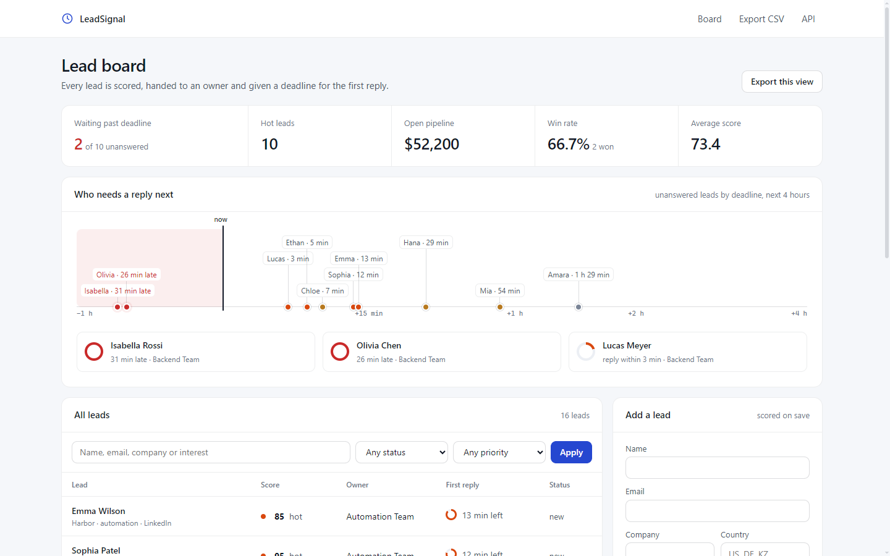
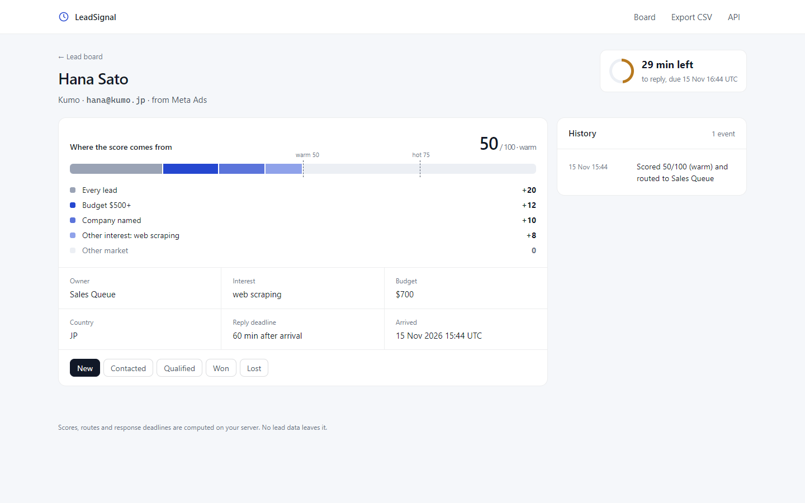
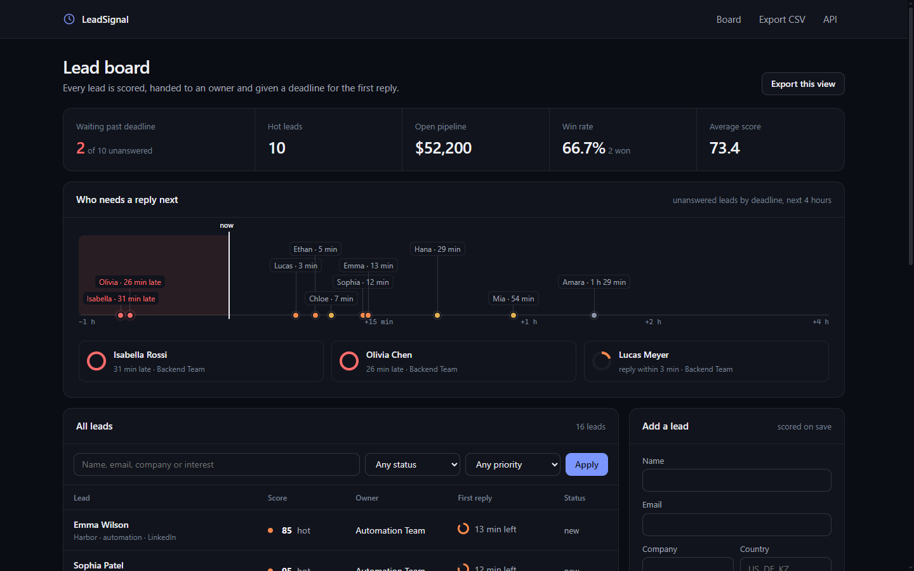

<div align="center">

# LeadSignal HQ

**Every incoming lead is scored, handed to the right owner and given a deadline for the first reply. The board shows who has to be answered next, before anyone is kept waiting.**

[](https://github.com/artyom129/leadsignal-hq/actions/workflows/tests.yml)


**🌐 Language:** **English** · [Русский](README.ru.md) · [Қазақша](README.kk.md)



</div>

---

## 📌 Why I built it

The first reply decides most deals. A lead from an ad, a website form or a partner API that waits two hours has usually found someone else by the time sales calls back. Yet most small teams sort leads by hand, in a shared inbox, in whatever order they arrive.

LeadSignal HQ makes the order explicit. Each lead gets a score from rules anyone can read, an owner by what they asked for, and a response deadline by priority: 15 minutes for hot, an hour for warm, four hours for the rest.

```text
Website / ads / API
        ↓
validate and normalise · block duplicates by email
        ↓
score 0-100 → hot · warm · normal
        ↓
route to Backend, Automation, Senior Sales or the sales queue
        ↓
reply deadline → the board → status workflow → CSV for the CRM
```

## 🔄 What's new in this version

| Area | How it works now |
| --- | --- |
| Input | Emails, names and budgets are checked and normalised; the form reports the problem in plain words |
| Duplicates | A unique index on email, and the race is caught and turned into "duplicate ignored" |
| Routing | Routing matches whole words; pipeline work goes to Automation |
| Scoring | Country names and codes both count; interest is case and space insensitive; the point values live in one place |
| Deadlines | The deadline is for the first reply, so only untouched leads can be late |
| Status | Five statuses, anything else is a 422 |
| Search | Search across name, email, company and interest, filters, paging, `%` and `_` as plain text |
| API | Paging, a single lead, status updates, stats and a formula-safe CSV export |
| Plumbing | Timezone-safe timestamps, startup migration for older databases, absolute paths, a health check that touches the database |
| Interface | A dispatch board, described below |

### 🎨 Design

The board is built like a departures screen at a dispatch desk. Cool ink neutrals, one blue accent, and three colours that only ever mean priority: hot, warm, normal.

At the top is the reply timeline: every unanswered lead sits at the moment its deadline runs out, from an hour late on the left to four hours ahead on the right. The scale is a square root, so the next fifteen minutes, where the urgent leads are, get as much room as the two hours after them. Below it, the three people who need an answer first. Each lead carries a small reply clock: a full ring means the whole window is left, red means late.

Every lead page shows where its score comes from as one bar of five parts with the warm and hot thresholds marked, so a salesperson can see at a glance why a lead is hot and what it would take to be.

| A lead | The board, dark theme |
| --- | --- |
|  |  |

## 🧮 How a lead is scored

| Part | Points |
| --- | --- |
| Every lead | 20 |
| Budget from $500 / $2,000 / $5,000 | 12 / 25 / 35 |
| Company named | 10 |
| Core service (automation, API integration, FastAPI, CRM integration, data pipeline) / anything else | 20 / 8 |
| Priority market (US, Canada, UK, Australia, Germany, Switzerland) | 10 |

75 and above is hot (reply within 15 minutes), 50 and above warm (60 minutes), the rest normal (4 hours). The highest possible score is 95.

## 🚀 Quick start

Python 3.11 or newer.

```bash
python -m venv .venv
# Windows: .venv\Scripts\activate
# macOS/Linux: source .venv/bin/activate
pip install -r requirements.txt
python seed_demo.py        # 16 leads, some late, some due in minutes
uvicorn app.main:app --reload
```

Board: http://127.0.0.1:8000 · API docs: http://127.0.0.1:8000/docs

### Docker

```bash
docker build -t leadsignal .
docker run -p 8000:8000 leadsignal
```

Set `LEADSIGNAL_DB_URL` to point at another database.

## 🌐 API

| Route | What it does |
| --- | --- |
| `POST /leads` | Create a lead from JSON; returns the lead and whether it was new |
| `GET /api/leads` | List with `q`, `status`, `priority`, `limit`, `offset` |
| `GET /api/leads/{id}` | One lead |
| `PATCH /api/leads/{id}/status` | Move to new, contacted, qualified, won or lost |
| `GET /api/stats` | Totals, hot leads, overdue, win rate, pipeline value |
| `GET /api/leads/export.csv` | The current view as CSV, safe to open in Excel |
| `GET /health` | Checks the database |

## 🧪 Tests

```bash
pytest -q
```

63 tests run against an in-memory database: input validation, duplicates and the unique index, scoring steps and country names, whole-word routing, deadlines, status rules, search with `%`, paging, the score breakdown, the board's order and scale, readable activity, the lead page, HTML and API errors, escaping and the CSV export.

## 📂 Project layout

```text
app/
├── main.py       # routes, board and lead pages
├── services.py   # validation, duplicates, status, search, stats, board, CSV
├── scoring.py    # points, breakdown, routing
├── models.py     # Lead and Event
├── db.py         # engine, startup migration
└── static/
templates/        # board, lead page, 404
seed_demo.py      # demo leads
tests/            # pytest
```

## ⚠️ Limits

- The board has no login. Keep it on localhost or behind a VPN or a proxy with auth.
- Scoring is rule-based on purpose: anyone can read why a lead got its number. Change the numbers in `app/scoring.py`.
- SQLite by default. Point `LEADSIGNAL_DB_URL` at PostgreSQL for a team.

---

<div align="center">

*Built and maintained by [Koncha Artyom](https://github.com/artyom129). MIT license.*

</div>
