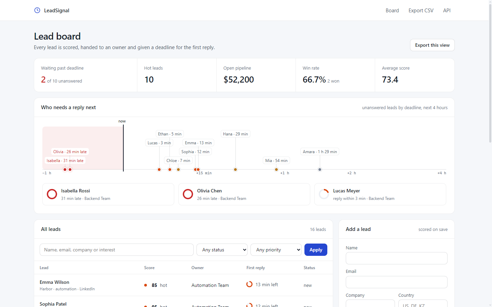
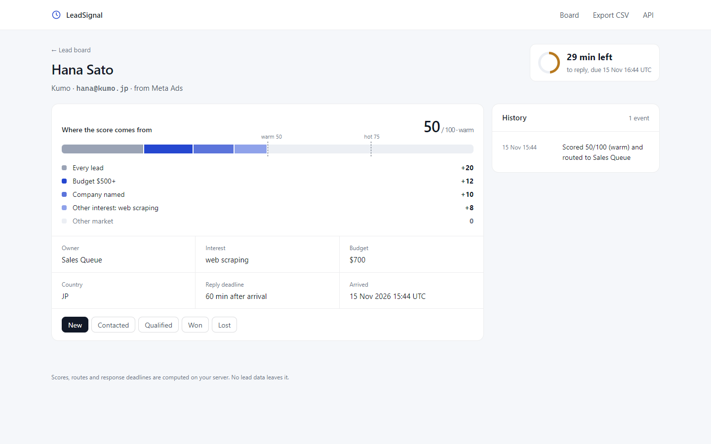
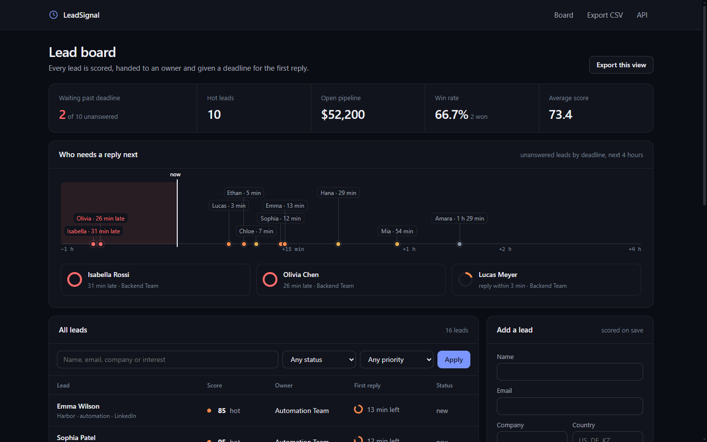

<div align="center">

# LeadSignal HQ

**Каждый входящий лид получает оценку, ответственного и дедлайн первого ответа. Табло показывает, кому нужно ответить следующим, пока никто не заждался.**

[](https://github.com/artyom129/leadsignal-hq/actions/workflows/tests.yml)


**🌐 Язык:** [English](README.md) · **Русский** · [Қазақша](README.kk.md)



</div>

---

## 📌 Зачем я это сделал

Первый ответ решает большинство сделок. Лид из рекламы, с формы на сайте или из API партнёра, который ждёт два часа, к звонку менеджера обычно уже нашёл кого-то другого. А маленькие команды всё равно разбирают лиды руками, в общем ящике, в порядке поступления.

LeadSignal HQ делает порядок явным. Каждый лид получает оценку по правилам, которые может прочитать любой, ответственного по тому, что человек попросил, и дедлайн ответа по приоритету: 15 минут для горячих, час для тёплых, четыре часа для остальных.

```text
Сайт / реклама / API
        ↓
проверка и нормализация · блокировка дублей по email
        ↓
оценка 0-100 → hot · warm · normal
        ↓
маршрут: Backend, Automation, Senior Sales или общая очередь продаж
        ↓
дедлайн ответа → табло → смена статусов → CSV для CRM
```

## 🔄 Что нового в этой версии

| Что | Как теперь работает |
| --- | --- |
| Ввод | Email, имя и бюджет проверяются и нормализуются; форма объясняет проблему обычными словами |
| Дубли | Уникальный индекс по email, гонка ловится и превращается в «дубль проигнорирован» |
| Маршрутизация | Маршрут ищет целые слова; работа с пайплайнами идёт в Automation |
| Оценка | Учитываются и названия стран, и коды; интерес не зависит от регистра и пробелов; баллы собраны в одном месте |
| Дедлайны | Дедлайн касается первого ответа, поэтому опоздать может только нетронутый лид |
| Статус | Пять статусов, всё остальное ответ 422 |
| Поиск | Поиск по имени, email, компании и интересу, фильтры, постраничность, `%` и `_` как обычный текст |
| API | Постраничность, отдельный лид, смена статуса, статистика и экспорт CSV без формул |
| Обвязка | Время без проблем с часовыми поясами, миграция старых баз при запуске, абсолютные пути, проверка здоровья через базу |
| Интерфейс | Диспетчерское табло, о нём ниже |

### 🎨 Дизайн

Табло сделано как экран вылетов в диспетчерской. Холодные чернильные нейтральные тона, один синий акцент и три цвета, которые означают только приоритет: hot, warm, normal.

Наверху шкала ответов: каждый неотвеченный лид стоит в момент, когда истекает его дедлайн, от часа опоздания слева до четырёх часов вперёд справа. Шкала корневая, поэтому ближайшие пятнадцать минут, где и сидят срочные лиды, получают столько же места, сколько два часа после них. Под ней три человека, которым нужно ответить первыми. У каждого лида маленькие часы ответа: полное кольцо значит, что всё время ещё впереди, красное значит опоздание.

На странице каждого лида видно, откуда взялась его оценка: одна полоса из пяти частей с отметками порогов warm и hot. Менеджер сразу понимает, почему лид горячий и чего ему не хватает, чтобы им стать.

| Лид | Табло, тёмная тема |
| --- | --- |
|  |  |

## 🧮 Как считается оценка

| Часть | Баллы |
| --- | --- |
| Каждый лид | 20 |
| Бюджет от $500 / $2 000 / $5 000 | 12 / 25 / 35 |
| Указана компания | 10 |
| Основная услуга (automation, API integration, FastAPI, CRM integration, data pipeline) / другое | 20 / 8 |
| Приоритетный рынок (США, Канада, Великобритания, Австралия, Германия, Швейцария) | 10 |

75 и выше это hot (ответ за 15 минут), 50 и выше warm (60 минут), остальное normal (4 часа). Максимально возможная оценка 95.

## 🚀 Быстрый старт

Python 3.11 или новее.

```bash
python -m venv .venv
# Windows: .venv\Scripts\activate
# macOS/Linux: source .venv/bin/activate
pip install -r requirements.txt
python seed_demo.py        # 16 лидов, часть опоздала, часть ждёт через минуты
uvicorn app.main:app --reload
```

Табло: http://127.0.0.1:8000 · документация API: http://127.0.0.1:8000/docs

### Docker

```bash
docker build -t leadsignal .
docker run -p 8000:8000 leadsignal
```

Чтобы использовать другую базу, задайте `LEADSIGNAL_DB_URL`.

## 🌐 API

| Маршрут | Что делает |
| --- | --- |
| `POST /leads` | Создать лид из JSON; возвращает лид и признак, новый ли он |
| `GET /api/leads` | Список с `q`, `status`, `priority`, `limit`, `offset` |
| `GET /api/leads/{id}` | Один лид |
| `PATCH /api/leads/{id}/status` | Перевести в new, contacted, qualified, won или lost |
| `GET /api/stats` | Итоги, горячие лиды, просроченные, доля выигранных, сумма в работе |
| `GET /api/leads/export.csv` | Текущий вид в CSV, безопасно открывать в Excel |
| `GET /health` | Проверяет базу |

## 🧪 Тесты

```bash
pytest -q
```

63 теста на базе в памяти: проверка ввода, дубли и уникальный индекс, ступени оценки и названия стран, маршрут по целым словам, дедлайны, правила статусов, поиск с `%`, постраничность, разбор оценки, порядок и шкала табло, понятная лента событий, страница лида, ошибки HTML и API, экранирование и экспорт CSV.

## 📂 Структура

```text
app/
├── main.py       # маршруты, табло и страница лида
├── services.py   # проверка, дубли, статусы, поиск, статистика, табло, CSV
├── scoring.py    # баллы, разбор оценки, маршрутизация
├── models.py     # Lead и Event
├── db.py         # подключение, миграция при запуске
└── static/
templates/        # табло, страница лида, 404
seed_demo.py      # демо-лиды
tests/            # pytest
```

## ⚠️ Ограничения

- У табло нет входа. Держите его на localhost или за VPN либо прокси с авторизацией.
- Оценка нарочно построена на правилах: любой может прочитать, откуда взялось число. Цифры меняются в `app/scoring.py`.
- По умолчанию SQLite. Для команды направьте `LEADSIGNAL_DB_URL` на PostgreSQL.

---

<div align="center">

*Сделал и поддерживает [Koncha Artyom](https://github.com/artyom129). Лицензия MIT.*

</div>
